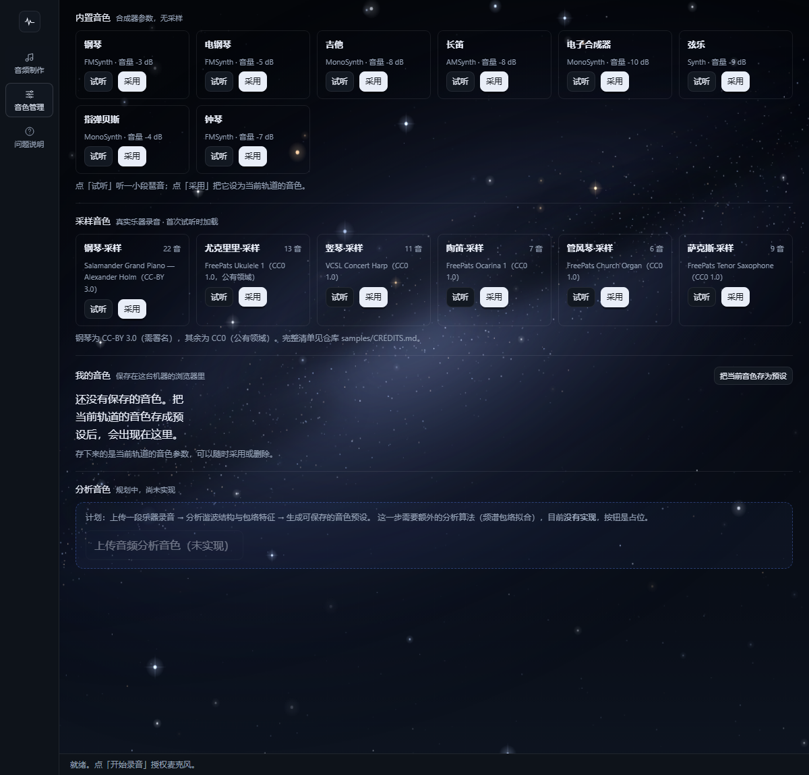

# 麦克风 → 音高提取 → 合成发声（单页原型）

**在线地址：https://zhu159666.github.io/Sing-Your-Song/** · 仓库：[zhu159666/Sing-Your-Song](https://github.com/zhu159666/Sing-Your-Song)

> 用这个网址打开就能录、能编、能导出；手机浏览器还可以"添加到主屏幕"当 App 用。
> 更新网站：双击 `update-site.cmd`，它会同步文件并推送，30 秒后刷新即可。

一个 `index.html`，两个按钮，一个 `<pre>`。**录制 → Basic Pitch 提取音符 → Tone.Synth 回放**。

## 怎么跑

必须用 **http(s)** 打开：浏览器只在「安全上下文」里给麦克风。

```bash
cd pitch-prototype
python -m http.server 8000
# 或： npx serve .
```

然后打开 <http://localhost:8000>。

> 直接双击 `file://` 在 Chrome/Edge 上偶尔能录，但 Safari/Firefox 会拒绝，而且 `file://` 的
> 模块导入容易出现 CORS 报错。**用 localhost，别省这一步。**

操作：点「开始录音」→ 对着麦克风哼一段（1~10 秒就够）→ 点「停止录音」。
处理完结果打在上方文本框里，随后自动回放。

## 装成 App（PWA）

用 http(s) 打开时，浏览器会出现"安装"入口；装好后是独立窗口、有图标、可离线。

- `manifest.webmanifest`：名称、图标（192/512，含 maskable）、standalone 显示、深色主题色。
- `sw.js`：只缓存**应用外壳**（index.html / vendor/Tone.js / manifest / 图标），
  跨域请求（CDN、模型）一律放行——避免把几 MB 的模型缓存进壳里。
- 断网时：页面能开、能编辑、能播放（Tone.js 在 `vendor/`），识别会退回内置 YIN。

**手机端**：左栏变顶部横条、工具条横向滑动、触控目标 ≥40px、时间轴轨头收窄到 96px。
触屏没有 Shift 键，所以工具条里加了「选择」开关：开启后拖拽 = 框选
（`touch-action: none` 防止滚动抢手势），选中后出现「删除选区」「±12 移调」与力度滑杆；
再点一次「选择」退出。

## 桌面版（Electron）

双击运行的桌面软件，不是网页。

```bash
npm install            # 首次（下载 Electron 运行时）
npm start              # 开发运行
npm run dist           # 打免安装单文件 exe → dist/
```

产物：`dist/Hum2Song 0.1.0.exe`（单文件，约 90MB，双击即用，无需安装 Node/浏览器）。

**三个关键决定：**

1. **用 `app://` 协议加载，不用 `file://`。**
   Chromium 里 `file://` 不是安全上下文，`getUserMedia` 会直接不可用——录音功能会整个失效。
   `main.js` 注册了一个 secure 的自定义协议，页面地址是 `app://bundle/index.html`，
   于是麦克风和 `fetch` 都正常。
2. **Tone.js 打包进应用**（`vendor/Tone.js`，345KB UMD），播放不依赖网络。
   识别引擎 Basic Pitch 仍需联网拉模型；**断网时自动退回内置 YIN**，录播链路照样走通。
3. **安全边界**：`nodeIntegration: false`、`contextIsolation: true`，
   页面只能通过 `preload.js` 拿到 `saveProject` / `openProject` 两个方法。

**没做的**：代码签名。所以首次运行 Windows 可能弹"未知发布者"，选"仍要运行"即可；
要消除提示需要买证书，或者在打包机上用管理员权限跑 `npm run dist`。

## 界面




左侧是类似 VSCode 的窄导航栏，三个视图：**音频制作 / 音色管理 / 问题说明**。
（截图里的音符是注入的示例数据。）

**布局是「通栏 + 分隔线」式，不是卡片堆叠**：整页一个背景色，各区块用 1px 分隔线切开、
内容通栏铺满，不再把背景切成一块块圆角卡片。

**层次靠三种底色区分**：左栏 `#0f151f`（亮一档，带竖向渐变）、主区 `#090c12`、
时间轴画布 `#070a0f`（半透明，能看到背后的星光）。左侧栏还有右缘投影。

**星空主题（两层 canvas）**：

- `#sky`（静态，只在 resize 时重画）：夜空渐变（天顶黑、地平线微亮）+ **斜穿画面的银河带**
  （三层椭圆光晕 + 1500 颗沿带轴高斯分布的小星）+ **模糊椭圆暗尘**（真实照片里银河被暗尘
  切成几缕，用 `ctx.filter: blur(20px)` 画才自然）+ 三团星云 + 460 颗散落暗星。
- `#stars`（动态，每帧）：约 190 颗亮星，各自相位闪烁、2–5 px/秒缓慢漂移；亮星带径向光晕，
  其中一半带**十字衍射星芒**（`globalCompositeOperation: 'lighter'` 叠加）。
- 星色带色温差异：暖白 / 冷蓝 / 正白，不是一种白。
- 时间轴画布半透明，星光会从编辑格里透出来。

**动效 UI**（全部走 Web Animations API + CSS，无第三方库）：

| 场景 | 动效 |
| --- | --- |
| 切换视图 | 整页淡入上浮，内部区块按 45ms 依次错开 |
| 新建轨道 | 该行从左侧滑入 |
| 画一个音符 | 音符从 0.45 倍弹出（带一点回弹） |
| 鼠标在格子上 | 一格高亮跟着指针走，告诉你点下去会落在哪 |
| 状态栏文字 | 换内容时闪烁淡入 |
| 按钮 | 悬停浮起、按下下沉 |

所有动效都过 `animateEl()`：系统开了 `prefers-reduced-motion` 就整体跳过。

- **设计令牌集中在 `:root`**，改一处全局生效。
- **动效只用 Web Animations API + CSS**，没引入 Motion One 或 GSAP——这个工具只需要微交互
  （面板入场、音符浮起、录音呼吸点），再挂一个 CDN 依赖换不来效果，却多一个加载失败点。
  全部做了能力检测，不支持就跳过。
- **卷帘配色按音高在「薄荷 → 蓝」之间取色**，不是彩虹色；黑键行有浅底色，深色下才分得清行。
- **空的时间轴用重复网格线表示"还在继续"**，不留死黑。
- 推理时显示**真实进度条**（接的 Basic Pitch 的 percent 回调）。
- 响应式：窄屏下左侧栏会折成顶部横条。

## 设计取向

界面按 [unslop](https://github.com/heydamir/unslop)（Damir Sokolovsky，CC BY 4.0）的方法重做过一遍：
**安静的界面 + 一处真正漂亮的焦点**。

- 主色不再是蓝到紫的渐变和发光按钮：深色主题下主按钮用中性亮面 `#e9eef8` 配深字，
  强调色只出现在选中态和焦点环。
- 图标统一成一套线条图标（16px / 1.5 描边），不再用 ♪ ◈ ? 这类字符当图标。
- 星空退成背景（去掉星云色块和会呼吸的光晕），钢琴卷帘才是内容主角。
- 间距回到 4px 网格，分隔线统一为 `rgba(233,238,248,.09)` 的发丝线。
- 动效只保留能解释事情的：切页淡入、新音符弹出、格子高亮、**加音符时的点击火花**
  （点击火花移植自 [React Bits](https://reactbits.dev) 的 ClickSpark，改写成无框架版本）。

## 音频制作

**整页只有两块**：一条紧凑的工具条（左：录音/导入/引擎/去噪/网格/BPM/低音/循环，
右：播放/导出），加一块**时间轴**（时间轴和音符编辑已经合并，不再分两个面板）。

- **时间轴默认 50 小节**，「＋20 小节」每次追加 20，一直加下去。
- **轨道**：「＋新轨道」加任意多条旋律轨，每条有独立音色；点泳道即选中，✕ 删除（至少留一条）。
- **每条轨道自带音色下拉**（挂在轨头里），不是全局一个选择器——每条轨真的是独立的乐器，
  新增的轨道默认钢琴、可以单独换、互不影响。
- **每条轨道都有自己的音阶网格**（不是"选中才展开"）：所有轨道同时显示、同时可编辑，
  点格子加音、点方块删音。
- **轨名就是音色**：轨头那个下拉既是标题也是音色选择器，换成「钟琴」这条轨就叫钟琴。
- **左侧栏宽度可拖**：拖轨头右缘调整，宽度存进浏览器（下次打开还记得），默认 118px。
- **每条轨道一个色相**：轨头圆点、选中高亮、音符块都跟随它，多条轨一眼能分清；
  音符在轨内再按音高做 ±13° 微调，所以既有"轨色"又能看出高低。
- **标题条独占一行**，音高网格从它下面开始，不会压住第一行音高。
- **鼓点**：6 条泳道（底鼓/军鼓/闭镲/开镲/拍手/通鼓），点一下加、同格再点删。
- **导入音频**：选本地 mp3/wav/ogg/m4a，走和录音相同的解码→去噪→提取→清洗链路。
- **撤销 / 重做**：`Ctrl+Z` / `Ctrl+Shift+Z`，最多 80 步，覆盖加删音符、鼓点、轨道、粘贴、清空。
- **播放头 / 定位**：点上方刻度尺任意位置，播放头跳过去；再播放就从那儿开始。
- **缩放**：网格宽度 50%–200%（12–56px），存在 localStorage。
- **分享链接**：工程 → JSON → deflate-raw 压缩 → base64url → `#p=` 哈希；打开带哈希的链接自动恢复。
- **和弦推断**：按小节用三和弦匹配音级（时值加权 + 根音加成），结果画成时间轴上方的和弦行；
  低音开关打开时，低音轨改弹和弦根音。
- **导出 MIDI**：标准 .mid（Type 1，480 PPQ），每条旋律轨一个 MTrk、鼓轨走通道 10。
- **测速**：对能量包络做自相关，60–180 BPM 内取值，带常见区间偏置避免锁成半速/倍速。
- **调性检测 + 音阶吸附**：Krumhansl 轮廓相关度判调，首尾音加权；吸附把跑调的音就近拉回音阶。
- **力度编辑**：框选后出现力度滑杆（批量），单颗音符 Alt + 上下拖改。力度进 MIDI 导出（映射到 velocity）和播放。
- **混音条**（时间轴下方）：每轨一条通道 —— 推子 dB / 声像 / 三段 EQ（低 250Hz 分频、高 2.5kHz 分频）/
  混响发送 / 静音 / 独奏。信号链是 `乐器 → EQ3 → Channel → 主输出`，另有一条共享混响总线；
  **导出 WAV 走同一套通道条**，听到的和导出的一致。
- **节拍器 / 预备拍**：勾上后播放与录音都打拍子；录音前先给 4 拍预备。
- **工程自动保存**：每次改动 0.5 秒后存进 `localStorage`，重开页面自动恢复；
  底部「工程数据」可导出/导入 JSON 做备份或换机器。
- **拖动编辑**：拖方块移动（时间+音高）、拖右缘改长度、框选多个一起拖。
- **复制一段旋律**：按住 `Shift` 在格子上拖框选区（按住 Shift 时光标会变成十字）→ `Ctrl+C`（或点「复制」）→ 点目标格子粘贴。
  默认音高原样复制，**轨道音阶范围会自动扩展到装得下**；按住 `Alt` 再点目标格子，
  则整段**移调**，让旋律的最低音落在你点的那一行上。剪贴板会保留，可以连续贴到多处。
- 状态信息在**底部状态栏**。

**快捷键**（焦点在输入框/下拉框里时不生效）：

| 键 | 作用 |
| --- | --- |
| `空格` | 播放 / 停止 |
| `R` | 开始 / 停止录音 |
| `N` | 新建轨道 |
| `Ctrl+C` | 复制选区音符 |
| `Ctrl+V` | 进入粘贴模式（再点目标格子） |
| `E` | 导出 WAV |
| `+` | 时间轴 +20 小节 |
| `Esc` | 停止播放 |

> 两个性能细节：① 时间轴上的音符用绝对定位色块，不铺每格 DOM，50 小节也只是几十个元素；
> ② 展开轨的音高范围**只扩不缩**——否则刚点出来的音会把范围顶高一行，同一屏幕位置对应的音高
> 就漂移了，表现为"想删掉刚加的音，结果在旁边又加了一个"（这个 bug 是实测撞出来的）。

## 音色管理

- 8 个内置音色（钢琴 / 电钢琴 / 吉他 / 长笛 / 电子合成器 / 弦乐 / 指弹贝斯 / 钟琴），
  都能「试听」（一小段琶音）和「采用」（设为当前轨道音色）。
- 「把当前音色存为预设」→ 存进浏览器 localStorage，出现在「我的音色」里，可再采用或删除。
- **分析音色是规划中的功能，没有实现**：那一栏明确写着未实现，按钮是禁用的占位。

> 为什么音色"不好听"：干声合成器怎么调都塑料。这次真正的改动是加了一条**总线**——
> `Compressor → Freeverb → 输出`。Freeverb 是算法混响，不需要任何 IR 采样文件，
> 离线渲染也能用，所以"无第三方采样"的承诺依然成立。这才是听感提升的主要来源。


## 输出字段

```
引擎        : Basic Pitch 1.0.1（模块源 esm.sh，模型源 cdn.jsdelivr.net）
原始录音    : 3.42 s, 48000 Hz, 1 声道
送入模型    : 3.42 s, 22050 Hz, 1 声道（75452 采样）
预处理      : 高通 80Hz · 归一化 ×3.20 · 静音门(阈值 0.0308，本底 0.0123)
清洗        : 原始 6 → 2 音（合并 4 · 丢弃过短 0 · 网格 0.25s）
音符数量    : 9
鼓点数量    : 6

[
  {"i":1,"midi":60.02,"note":"C4","start":0.371,"dur":0.412,"amp":0.83,"hz":261.73},
  ...
]
```

- `midi` — MIDI 音高（60 = C4，69 = A4）。带小数表示检测到的微偏差，回放时直接用小数，更接近原音。
- `start` — 相对**录音开头**的秒数（含开头的静音）。
- `dur` — 持续秒数。
- `amp` — 模型给出的能量，用来折算回放力度。

同时 `console.log` 里也有一份，方便你打断点。

## 去噪（勾选框，默认开）

链路：**四阶高通 80Hz → 峰值归一化 → 静音段噪声门**，纯本地信号处理，不引入额外依赖。

同一段 2 音符音频叠加白噪声（理想输出：2 个音符），实测对比：

| 处理 | SNR 20dB | SNR 10dB |
| --- | --- | --- |
| 不处理 | 6 音 | 8 音 |
| 峰值归一化 | 6 | 8 |
| 带通 80–2000Hz | 6 | 6 |
| 噪声门 | 6 | 8 |
| 谱减法（STFT 过减） | 7 | 7 |

结论反直觉：**没有一种去噪能修复「有声段被切碎」**。故障点在 onset 峰判定，不在「能量不够干净」；
谱减法的残余音乐噪声还会制造新峰（20dB 那列反而变多），所以没做进产品。

那层真正管用的只有两件事：

- **静音段噪声门**——清掉「没人唱的时候冒出假音符」。带两道安全阀：信号与本底对比不足
  （整段都在发声、没有停顿）时自动跳过；门掉超过 80% 能量时回退。**绝不会把整段录音门成静音**。
  实测：音符结束后约 100ms 淡出，之后 −180dB。
- **四阶高通 80Hz**——压掉工频嗡声。实测 50Hz −17.6dB、82Hz −5.6dB、440Hz 完全不受影响。

> 切分碎片的正确解法是**输出端「相邻同音合并」**（同音高、间隔 <120ms 合并），不是降噪。

另外实测：这段合成纯音在 **SNR 40dB（噪声几乎听不见）就已经开始碎**。所以别指望「把噪声洗干净
就能救回切分」——真人声有谐波和共振峰，没这么脆，但方向一致。

## 数据清洗与量化

流水线：**同音高相邻合并 → 过滤过短 → 吸附网格 → 同格合并 → 单声部整理**。

| 参数 | 值 | 说明 |
| --- | --- | --- |
| `minDuration` | 0.1s | 短于此值当杂音丢掉 |
| `mergeGap` | 0.05s | 同音高、间隔小于此值合并（相邻碎片的间隔实测常常正好是 0） |
| `grid` | 0.25s（可选 0.125 / 0.5 / 关闭） | 起点与时长都吸附到网格 |

两处和「朴素实现」不同，都是为了让结果听起来像人而不是卡带：

- **先合并再过滤**。顺序反过来的话，一段连续音被切成的碎片会先被逐片删光（每片都不到 0.1 秒），
  合并就无从谈起。实测数据上两种顺序结果相同，但这样更稳。
- **量化后还要做两步收尾**。只把起点 `round(t/0.25)*0.25` 是不够的：
  ① 两个音会被撞到同一格 → 必须合并或留强的；
  ② 前一个音的时长不变的话会盖住后一个音的起点 → 必须"清音尾"。
  这两件不做，量化出来就是叠音和抢拍，比不量化更难听。

**实测（真实模型输出 → 清洗）**

| 输入 | 原始提取 | 清洗后 |
| --- | --- | --- |
| A4→C5，白噪声 SNR 20dB | 6 个碎音（69@0.14/0.31/0.46/0.80，72@1.00/1.27） | **2 个**：`69@0.25+0.75`、`72@1.00+0.50` |
| A4→C5，白噪声 SNR 10dB | 8 个碎音 | **2 个**：`69@0.00+1.00`、`72@1.00+0.50` |
| 单一持续音 E2（被切成 3 片） | `40@0.00+0.17` `40@0.17+0.63` `40@0.80+0.14` | **1 个**：`40@0.00+1.00` |

另外：清洗后，"先去噪再提取"和"直接提取"结果**完全一样**——碎音最后都被合并掉了。
所以去噪的价值只在静音段假音符和工频嗡声，切分问题归清洗管。

**网格怎么选**：0.25s ≈ 每秒最多 4 个音。哼得比这快，音符会被吃掉——换成 0.125s。
觉得节奏还是散，就调到 0.5s。全部不想要就选「关闭」。

## 钢琴卷帘（可视化 + 手动修正）

录完（或手绘）之后，音符会画成网格里的彩色方块：**纵轴是音高**（左侧标 C4/D4…），**横轴是时间**
（顶部标秒数），颜色按音高取色、明暗跟力度走。

- **点空白格** → 加一个音符（长度 = 一个网格）
- **点方块** → 删掉这个音符
- **▶ 播放** 随时试听当前编辑结果，不用重录
- **清空** 全部删掉，从零手绘

**为什么不是死板的 8×8**：固定 8 行会截断真实旋律（哼两个八度就画不下），固定 8 列装不下
2 秒以上的录音。所以是**最少 8×8、按实际音域和时长自适应扩张**（上限 48 列），空网格默认
C4–B4 一带，够你直接手画。

**数据流**：`currentNotes` 是唯一真相，卷帘、JSON、回放全部从它渲染。所以手动改的和 AI 提取的
走同一条通路——改完点播放，听到的就是你改的；<details> 里的 JSON 也会同步更新成改后的样子。

**一个已知取舍**：换「网格」步长**不会**重新量化已有音符，只影响下次提取和手绘吸附
（状态行会提示）。静默改动已经画好的音符太容易让人莫名其妙；要重排就重录一次。

## 多轨与播放

轨道 = **事件表 + 乐器**，两者解耦。加轨道只要往 `activeParts` 里多塞一个 `Tone.Part`，不用动引擎。

| 轨道 | 内容 | 音源 |
| --- | --- | --- |
| 旋律轨 ×N | 哼唱提取 / 导入 / 手动画 | 每条轨自己的 `Tone.PolySynth` 音色 |
| 低音 | **自动推导**，不用画 | `Tone.MonoSynth` |
| 鼓点 | 点格子加的打击点（6 件） | `MembraneSynth`(底鼓/通鼓) · `NoiseSynth`(军鼓/拍手) · `MetalSynth`(闭镲/开镲) |

轨道选择是"单编辑器"模式：一个卷帘，切轨道即切内容（和 DAW 一样），而不是每条轨铺一个卷帘。

**低音轨不用画**：它从**主旋律轨**实时推导——按 4 拍一小节分组，每小节取占时最长的那个音当根音，
下移八度落到低音区，铺满整小节（留 5% 缝）。JSON 里每条带 `from` 字段，能看到它是从哪个音推出来的。

**音色**：8 个内置（钢琴 / 电钢琴 / 吉他 / 长笛 / 电子合成器 / 弦乐 / 指弹贝斯 / 钟琴），
用了四类合成器（`Synth` / `FMSynth` / `AMSynth` / `MonoSynth`），并统一过一条
`Compressor → Freeverb` 总线。全部是合成器参数、不含采样。

> 为什么没用 `DuoSynth` / `PluckSynth`：`PolySynth` 只接受继承自 `Monophonic` 的声部。
> `PluckSynth` 确定不是（它没有 triggerRelease），`DuoSynth` 的继承链我没核实到，就没用。
> 要加得先验证，验证不过会在控制台退回 `Synth` 并留 warning。

**BPM 为什么不会把音符"重排"**：所有事件按时值换算成 `"小节:拍:十六分"` 记谱交给 `Tone.Part`，
Transport 按当前 BPM 解释它。所以拖 BPM 滑块是**整体变速**（包括鼓点），节奏比例不变。
实测三种网格（0.125/0.25/0.5s）都精确落在十六分音符上，不会因为记谱产生二次量化误差。

**循环**：`Transport.loop` + `loopEnd` 向上取整到整小节。关掉循环会走完一遍自动停。

> 军鼓我用的是 `NoiseSynth` 而不是题面说的 `MembraneSynth`：MembraneSynth 是"膜"（咚），
> 军鼓是"响弦噪声"（嗒）。用膜合成器打军鼓会变成一个音调偏高的桶鼓。

## 导出 WAV 与版权

「下载 WAV」用 `Tone.Offline` 渲染成一个真实的 WAV 文件，可以选循环 1 / 2 / 4 遍。

三个实现要点：

- **乐器必须现场新建**。离线渲染跑在独立上下文里，复用实时播放的实例会**静默不出声**（它们绑在另一个 context 上）。
  所以代码把"创建"和"缓存"拆开了：`createXxx(Tone)` 无缓存、`ensureXxx(Tone)` 只为实时播放加缓存。
- **播放和导出共用一份编曲快照**（`buildArrangement()`）。否则很容易出现"听到的"和"导出的"不是同一件事。
- **WAV 编码是手写的**（16bit PCM，44 字节头 + 交错数据）。浏览器没有内置编码器，
  为这点功能再引一个 CDN 依赖不划算。

**独立验证**：导出的文件用 Python 的 `wave` 模块 + numpy 重新解码——2 声道 / 44100Hz / 时长精确 1.00s /
左声道主频 440.0Hz、右声道 660.0Hz / RMS 0.354（= 0.5/√2），与输入完全一致。

导出时长有 180 秒上限，超了会提示先把 BPM 调高或减少遍数（避免一次性吃掉几百 MB 内存）。

页面底部有这项声明：

> 本工具基于开源合成器（MIT 协议）构建，不包含第三方采样版权。
> 用户基于自身哼唱生成的音乐，版权归用户所有，可自由用于商业用途。

这条声明和实现是一致的：所有音色都是合成器参数，一个采样文件都没有。

## 两个引擎

| 引擎 | 依赖 | 说明 |
| --- | --- | --- |
| Basic Pitch（主） | 网络：模块 + 模型 | 复音也能提取，准 |
| 内置 YIN（兜底） | **零依赖** | 单音高（哼唱够用），CDN 全挂时保证流程仍能跑通 |

下拉框可以强制指定。选「自动」时：Basic Pitch 失败会自动退回 YIN，并在结果里注明原因。

## CDN 策略（为什么不是写死一个链接）

- 库的 `esm/index.js` 用了**没有扩展名**的相对导入（`from './inference'`），浏览器原生 ESM 无法解析，
  所以不能直接 `import` unpkg 的原始文件。必须用会重写裸导入的构建：
  `esm.sh` → `jsDelivr 的 /+esm`（自动降级）。
- 模型 `model/model.json` + `group1-shard1of1.bin` 就在 npm 包里，按 `jsDelivr` → `unpkg` 顺序试。
- `@spotify/basic-pitch` **不在 npmmirror 的 unpkg 白名单**里，淘宝源取不到这个包的文件（实测 403），
  所以没把它列进候选。
- 想换源：改文件顶部的 `MODEL_URLS` / `BP_MODULE_URLS` / `TONE_SCRIPTS` 三个常量。

## 写之前实测过的结果

不是照着文档抄的，下面都是跑出来的：

- **Basic Pitch 端到端（Node + CPU 后端，2 秒合成音频：A4 1.0s + C5 0.5s + 静音）**
  → 172 帧 × 88 bin，提取出 `MIDI 69 @ 0.00s`、`MIDI 72 @ 0.99s`，与预期一致。
- **踩到的坑**：`evaluateModel()` 对采样率/声道是**硬校验**（不是 22050Hz 单声道直接抛错），
  所以代码里自己做了重采样；库返回的音符**不按时间排序**（实测倒序），代码里补了 sort。
- **内置 YIN（合成信号）**：A4→69.01、C4/E4/G4→60/64/67（起点 0/0.39/0.79）、E2→40、静音→空；
  10 秒音频耗时 86ms。
- **去噪实验**：峰值归一化 / 带通 / 噪声门 / 谱减法 5 种方案，在 SNR 20dB 与 10dB 下都没能把
  2 音符还原成 2 个（详见「去噪」一节）。谱减法自检重建误差 0.1%，实现本身没问题，是方法不适用。
- **真实 mp3 跑通全链路**：23.38 秒 / 48kHz 立体声，经 ffmpeg 转 22050 单声道后，
  Basic Pitch 提取 25 个音符，清洗后 21 个，音域 B3–C#5。该文件是整段音乐，
  模型只抓到稀疏的旋律骨架（Basic Pitch 官方定位是"一次一种乐器"）。

## 常见问题

| 现象 | 原因 / 处理 |
| --- | --- |
| 状态行提示「拿不到麦克风 API」 | 用了 `file://`，换成 localhost |
| 授权了但录不到声音 | Windows 隐私设置里允许桌面应用访问麦克风；或麦克风被别的程序占用 |
| 推理很慢 | 浏览器没拿到 WebGL 后端会退回 CPU。实测纯 CPU 下 **2 秒音频要 ~10 秒**（Node 环境）；开 WebGL 快一个量级。把硬件加速打开 |
| `import()` 失败 | 网络到不了 esm.sh / jsDelivr。引擎切「仅内置 YIN」可先验证麦克风与合成链路 |
| 没检测到音符 | 录音 <1 秒、太安静、噪音大，或音高超出 55~1400Hz。靠近麦克风、一次哼一个音 |
| 回放没声音 | 浏览器自动播放策略：必须是点击触发。若 Tone.js 没加载成功，状态行会提示（提取结果仍然有效） |
| 清洗后音符变少/变怪 | 网格太粗（0.25s ≈ 每秒最多 4 个音）。哼得快就换 0.125s；不想量化选「关闭」 |
| 两个不同的音被合成一个 | 它们被量化撞到同一格了——单声部约束只留了更强的一个。调细网格 |
| 卷帘里看不到某个高音/低音 | 音域是自适应的，理论上不会截断；若确实超出，说明音符表为空（看 JSON 里的音符数量） |
| 改了「网格」方块没变 | 有意为之：换网格只影响下次提取与手绘吸附，不静默重新量化已有音符 |
| 拖 BPM 后鼓点和旋律对不齐 | 不会：两者都按拍记谱，一起变速。若确实错位，检查是不是关了循环又手动改了几何 |
| 只有一个轨道也能播 | 可以：只有鼓点或只有旋律都能播，播放按钮的启用条件是"至少一个轨道有内容" |
| 低音听起来和旋律打架 | 低音轨是"每小节一个根音"的最简跟随，不支持转位、经过音、切分。复杂编曲请关掉它自己画 |
| 点导出没反应 | 先看状态行：两个轨道都空会提示；超过 180 秒会提示降低遍数；Tone.js 没加载也会明确说 |
| 导出的文件很大 | 16bit PCM 立体声 ≈ 10MB/分钟。这是无损交换格式，要小就转 MP3（本工具不做编码） |

## 想改成实时（边唱边出声）

现原型是「录完 → 批量推理 → 回放」，延迟 = 录音长度。要实时：

1. 用 `AudioWorkletNode` 拿原始 PCM（别用 `ScriptProcessor`，已废弃且爆音）；
2. 每 40~80ms 取一窗，跑轻量单音检测（YIN，或者 CREPE tiny / SPICE）；
3. 检测结果直接 `Tone.Synth.triggerAttackRelease()` 立刻发声，音高变化做 `portamento`。

Basic Pitch 不适合实时：它是 2 秒窗 + 30 帧重叠的离线模型。

## 替代方案（Basic Pitch 加载不了时）

1. **本地 Python 版 basic-pitch**（最准，推荐做对照）：`pip install basic-pitch`，
   `basic-pitch out/ your.wav` 出 MIDI；前端只上传音频、拿回 MIDI 解析，完全绕开浏览器端模型加载。
2. **换更小的单音高库**：`pitchy`（YIN 封装，几 KB）或 CREPE-tiny，适合只需要单音高。
3. **直接用现成 ONNX 模型**：`onnxruntime-web` + 官方 `nmp.onnx`，自己写前后处理（工作量大，但可控）。

## 文件

- `index.html` — 全部代码（约 2450 行，侧边栏三视图 + 音频引擎）
- `preview.png` — 音频制作页截图（含示例音符）
- `preview-timbres.png` — 音色管理页截图
- `backups/` — 每完成一步留一份可运行快照，改崩了直接拷回来
  - `index_20261118_pre-clean.html` — 只有"录音+提取+去噪"，尚未加清洗与量化
  - `index_20261118_step1-clean.html` — 加了数据清洗与量化
  - `index_20261118_step2-roll.html` — 加了钢琴卷帘可视化与点击编辑
  - `index_20261118_step3-tracks.html` — 加了多轨 / 音色 / 鼓点 / BPM
  - `index_20261119_step3b-full.html` — 扩展到 6 鼓件 + 6 音色 + 自动低音轨
  - `index_20261119_step4-wav.html` — 加了 WAV 导出与版权声明
  - `index_20261119_step5-ui.html` — 深色界面改版
  - `index_20261119_step6-workspace.html` — 侧边栏三视图 + 多轨 + 音色管理 + 导入音频
  - `index_20261119_step7-timeline.html` — 剪映式时间轨道（50 小节 / +20）+ 全宽布局
  - `index_20261119_step8-merged.html` — 顶部压缩、时间轴与音符编辑合并、走带移到右上
  - `index_20261119_step9-keys.html` — 轨头可点选、钢琴键标签、轨道加高
  - `index_20261119_step10-pertrack.html` — 每轨独立音色下拉、行高 34px
  - `index_20261119_step11-polish.html` — 标题条独占一行、小号删除键、快捷键
  - `index_20261119_step12-align.html` — 时间轴改 flex 行结构（轨头/泳道严格对齐）、每轨配色
  - `index_20261119_step13-alltracks.html` — 每条轨道自带可编辑音阶、顶部工具条压缩
  - `index_20261119_step14-narrow.html` — 左栏收窄到 118px 且可拖动、轨名=音色、帮助页更新
  - `index_20261119_step15-flat.html` — 去掉卡片布局，改为 DSH 式通栏分隔线
  - `index_20261119_step16-depth.html` — 左栏/主区/画布三档底色区分，细节润色
  - `index_20261119_step17-stars.html` — 星空主题：canvas 星场 + 星云 + 按钮辉光
  - `index_20261119_step18-astro.html` — 天文摄影级星空（银河带/暗尘/星芒）+ 动效 UI
  - `index_20261119_step19-unslop.html` — 按 unslop 九道 pass 重做视觉（安静外框/线条图标）
  - `index_20261120_step20-sparkfix.html` — 修复点击火花位置偏移
  - `index_20261120_step21-copypaste.html` — 框选复制 / 点击粘贴 / Alt 移调
  - `index_20261120_step23-tier1.html` — 撤销重做 / 工程自动保存 / 拖动编辑（当前版本）
